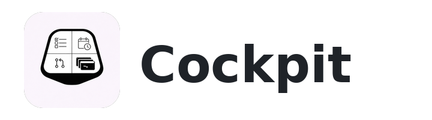

<p align="center">
  <picture>
    <source media="(prefers-color-scheme: dark)" srcset="public/banner-dark.png" />
    
  </picture>
</p>

<p align="center">A web UI for Claude Code that frees it from your terminal.</p>

https://github.com/user-attachments/assets/95241a55-8cc7-48b2-8f9b-b2ed58b8dfe2

Cockpit runs the real Claude Code CLI on a server, which can be your laptop or a box at home. Sessions keep going when you close the browser, and you can pick them up from any device, your phone included.

## What it does

- **Many sessions at once.** The sidebar shows which are working, waiting on you or done.
- **The real CLI.** Not a reimplementation. Cockpit drives Claude Code itself, headless (Stream) or in a pseudo-terminal (PTY). PTY keeps subscription usage on the interactive side.
- **Tabs and split view.** Chat, diffs, files and a terminal, side by side. Edit files in place.
- **Any model.** Claude, or any model on OpenRouter (free ones included), OpenCode Zen and Go, DeepSeek, Groq, Gemini, NVIDIA NIM or CommandCode, or your own Anthropic-compatible endpoint. Switch model mid-session. Tools, edits and permissions work the same on all of them.
- **Insights.** What each session and job costs, how fast each model is, and where the time goes.
- **Issue tracker.** Projects and issues on a board. Jobs refine and plan them. Sessions pick them up.
- **Scheduled jobs.** Unattended runs on a schedule, when an issue changes status, or after other jobs. Each has its own model, tools, MCP servers and time budget.
- **Inbox.** Job results land here, and on your phone through Telegram, ntfy or web push.
- **Cockpit Assistant.** Set Cockpit up by asking: jobs, providers, MCP servers, settings. Every change waits for your approval.
- **Your phone.** Install Cockpit as an app. Sessions can notify you when they finish or need you, and you can approve from the notification.
- **PR reviews.** Pick a PR and review it with Claude, the diff beside the chat.
- **Git.** Review changes, generate a commit message, commit and push.
- **Claude Code config.** Agents, skills, hooks, MCP servers, plugins and CLAUDE.md, all editable in the UI.
- **Small things.** Search every session (Ctrl+Shift+F), prompt history on the up arrow, messages that queue while Claude works, and `/btw` for a side question that doesn't interrupt.

Insights and the issue tracker are experimental and off by default. Turn them on in Settings → Appearance. Insights covers PTY sessions.

## Quick start

```sh
npx @alexjbarnes/cockpit
```

Or install it globally:

```sh
npm install -g @alexjbarnes/cockpit
cockpit
```

Open http://localhost:3001 and set a password. The startup log prints the local and network URLs.

## Prerequisites

- Node.js 22.23.4, 24.22.1 or 26.12.1, or a later release of the same line. Earlier releases still trust eMudhra's compromised CA keys.
- [Claude Code CLI](https://www.npmjs.com/package/@anthropic-ai/claude-code), on your PATH and signed in.
- [GitHub CLI](https://cli.github.com/) (`gh`), signed in, for PR reviews.

Tested on Linux and macOS. Windows is unverified.

## Configuration

| Variable | Description | Default |
|---|---|---|
| `PORT` | Port the server listens on | `3001` |
| `HOST` | Bind address | `0.0.0.0` |
| `COCKPIT_RESET_PASSWORD` | Set to `true` to reset password on next startup | `false` |
| `COCKPIT_CONFIG_DIR` | Cockpit config location (password, providers, defaults, jobs, inbox) | `~/.cockpit` |
| `CLAUDE_CONFIG_DIR` | Claude config and transcripts Cockpit reads | `~/.claude` |
| `COCKPIT_DEBUG` | Set to `1` to write a structured debug log | unset |

Set `COCKPIT_CONFIG_DIR` and `CLAUDE_CONFIG_DIR` together to run isolated instances side by side. [Settings](docs/settings.md#environment-variables) lists the rest.

## Remote access

Cockpit listens on all interfaces. On the host, open http://localhost:3001. From another device on your network, use the host's IP (the startup log prints it). From outside your network, use [Tailscale](https://tailscale.com/) rather than forwarding a port. Set `HOST=127.0.0.1` to keep Cockpit on the host.

## Documentation

- [Sessions](docs/sessions.md): chat, runtime modes, tabs, attachments, plan mode, diffs, files, search
- [Model providers](docs/providers.md): built-in and custom providers, the OpenAI translation proxy, context sizes, usage
- [Embedded terminal](docs/terminal.md): themes and the mobile key bar
- [PR reviews](docs/pr-reviews.md)
- [Scheduled jobs](docs/scheduled-jobs.md)
- [Settings](docs/settings.md): auth, models, providers, themes, notifications, inbox, updates, agents, skills, hooks, MCP servers, CLAUDE.md

## Development

```sh
npm install
npm run dev
```

Unit tests: `npx vitest run`. The [integration suite](docs/integration-tests.md) drives the real Claude Code CLI against a mock Anthropic API through Playwright. Issues and PRs welcome.

## License

Apache 2.0
